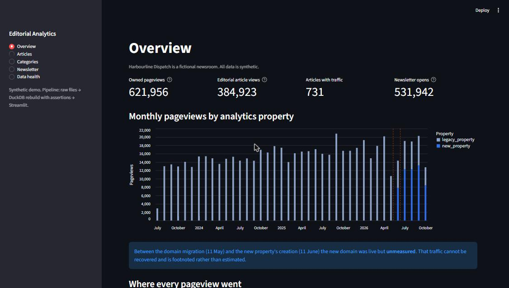

# Editorial Analytics Pipeline

**Turn messy, multi-source publishing analytics into one set of numbers you
can defend, and prove it every morning.**

```
 CMS registry ─┐
 analytics A ──┤   (old domain, daily)
 analytics B ──┼─► rebuild DuckDB from scratch ─► 8 invariants ─► Streamlit dashboard
 vendor export ┤   (new domain, hourly, other tz)      │
 newsletter ───┘   (lifetime-only, retired)            └─► daily health digest (CI)
```

A newsroom's traffic data rarely lives in one clean table. Domains migrate,
analytics vendors are retired, a second property gets set up in the wrong
timezone, and a newsletter carries several articles per edition. Each of
these, handled by hand, produces numbers that are confidently wrong: traffic
double-counted, gaps silently filled, averages summed.

This repository is a working pipeline that handles each case explicitly, on a
**fully synthetic newsroom**. The publication, articles, domains and numbers
are invented, and the generator recreates the real-world traps on purpose.

> **Origin.** This is a generalised, synthetic rebuild of a production
> pipeline I designed for a health-sector newsroom. The architecture and
> rules carry over; the code here is new, and contains none of that
> organisation's data, code, or credentials.



---

## What it gets right

| Trap | What goes wrong by hand | What the pipeline does |
|---|---|---|
| **Domain migration** | Every older article has two live URLs; traffic is split or lost | Resolves both URL shapes to one slug and **sums** old and new domains per article |
| **Retired vendor overlap** | A lifetime-only export is added to daily data covering the same readers | Kept at lifetime grain and shown **beside**, never added to, daily figures |
| **Second property in another timezone** | Hours land on the wrong day; a timezone setting can't fix history | Re-buckets hourly rows onto local days, DST-aware, and asserts totals are preserved |
| **Unmeasured month** | The gap is "estimated", or left unexplained | Left empty and **footnoted**; an assertion stops anything filling it |
| **Newsletter editions** | Opens summed per article count one open many times | Counted once per **edition**; per-article reach is shown, never summed |
| **Average of averages** | A tile sums per-article read times and reports ~200 "minutes" | Weighted mean (total engaged time ÷ total views), with the wrong versions shown for contrast |
| **Pages that aren't articles** | Homepage, archive and removed-post traffic silently vanishes | Every pageview lands in a named bucket; an assertion checks nothing is dropped |
| **Analytics creating articles** | A page title becomes a headline; deleted posts reappear | The CMS owns identity; unknown slugs are `removed_article`, never new rows |
| **Empty categories** | `SELECT DISTINCT` hides focus areas with no articles yet | Seeded vocabulary; empty areas show zero |

## How it works

1. **`src/generate_synthetic.py`** writes the raw sources to `data/raw/`. In
   production, this step would be the API pulls.
2. **`src/build_db.py`** rebuilds `data/analytics.duckdb` from scratch into a
   temporary file. It loads tables whose constraints encode the rules
   (`UNIQUE(slug)`, `NOT NULL DEFAULT 0`, explicit grain), creates the views,
   then runs **8 invariants** the schema can't express. The file only replaces
   the live database if every one passes, so a bad run can never leave the
   dashboard reading half-written data.
3. **`app/streamlit_app.py`** reads the database read-only. It has five pages:
   Overview, Articles, Categories, Newsletter and Data health.
4. **`src/diagnostics.py`** checks freshness and assertions and writes a
   Markdown digest. It exits non-zero when a human is needed.
5. **`.github/workflows/daily.yml`** runs the tests, generate, build and
   diagnostics every morning, and posts the digest to the run summary.

### The 8 invariants

1. Every analytics A pageview is accounted for (raw total = loaded total).
2. Every analytics B pageview is accounted for, after timezone re-bucketing.
3. The named buckets sum to the owned total.
4. Analytics never create articles.
5. Every newsletter link resolves to a registry article.
6. Old-domain plus new-domain views equal the article total, for every slug.
7. There is no new-property data dated before the property existed (this catches bad re-bucketing).
8. Every seeded focus area is reported, even with zero articles.

The build report, including each invariant's result and each source's
freshness, is stored inside the database. The dashboard's Data health page
and the morning digest both read it.

## Run it

```bash
pip install -r requirements.txt
python src/generate_synthetic.py      # ~2 s: 900 articles, ~240k analytics rows
python src/build_db.py                # ~2 s: rebuild + assertions
streamlit run app/streamlit_app.py    # or just run this; it builds on first launch
python src/diagnostics.py             # the morning digest
pytest -q                             # 24 tests
```

Why DuckDB in a file rather than a hosted database? At this scale the whole
dataset is a few megabytes of parquet and every dashboard query returns in
milliseconds. A file removes an account, a password and an idle-paused server.
It is rebuilt in seconds from its inputs, so it is gitignored rather than
committed.

## Tests

`pytest -q` runs 24 tests. They cover:
- timezone re-bucketing, including late-evening hours moving to the next local day and the repeated DST hour;
- path classification;
- the domain-sum and vendor-separation rules;
- the weighted mean against the wrong versions;
- once-per-edition newsletter counting;
- seeded empty categories and the unmeasured gap;
- a failed build leaving the previous database untouched;
- every dashboard page rendering.

## Repository layout

```
src/generate_synthetic.py   synthetic sources with deliberate traps
src/build_db.py             atomic rebuild + invariants (pure transforms are unit-tested)
src/diagnostics.py          freshness + assertion digest; non-zero exit = needs a human
sql/schema.sql              tables; constraints encode the design rules
sql/views.sql               the views the dashboard reads, each with the rule it enforces
app/streamlit_app.py        five-page dashboard
tests/                      pytest suite
.github/workflows/daily.yml scheduled build and digest
```

## How this was built

I designed the architecture, data rules, invariants and failure handling. I
used AI coding assistants for parts of the implementation, and I reviewed and
tested the code.

## License

MIT. See [LICENSE](LICENSE).
